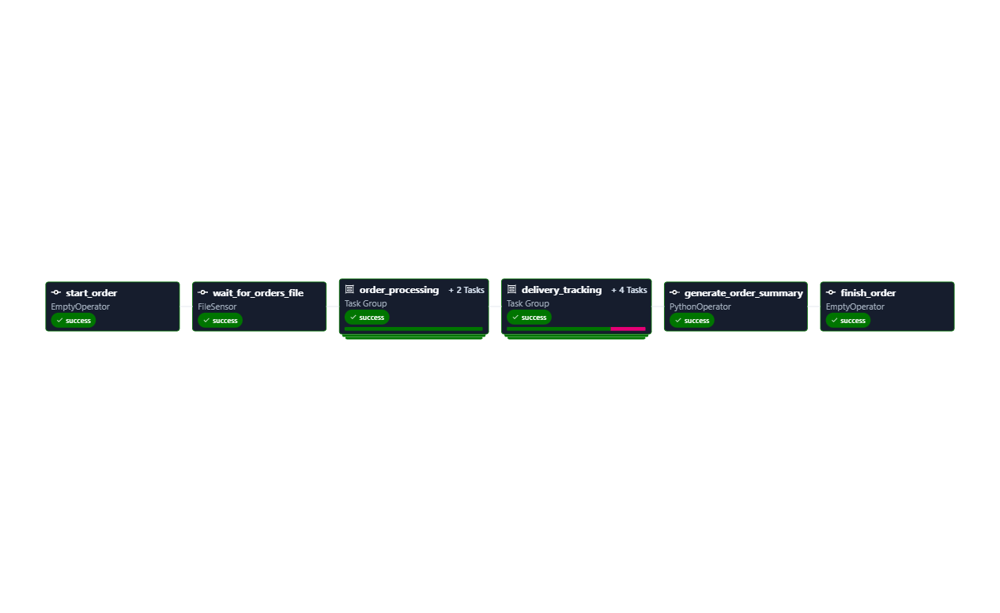

# Real-Time Food Delivery and Order Tracking Pipeline

A data pipeline project built using **Apache Airflow 3.3.1**, Python, and Docker Compose to demonstrate food order validation, processing, delivery tracking, and reporting.

## Project Overview

This project simulates a food delivery workflow using CSV order data. Apache Airflow orchestrates the tasks, manages dependencies, handles retries, and generates a JSON summary report.

## Tech Stack

* Apache Airflow 3.3.1
* Python
* Docker Compose
* CSV and JSON
* Git and GitHub

## Key Features

* **FileSensor:** Waits for the orders CSV file.
* **Data Validation:** Checks incoming order data.
* **TaskGroups:** Organizes order processing and delivery tracking.
* **Branching:** Selects a tracking path based on processing results.
* **Retries:** Configures retry behavior for task failures.
* **Order Tracking:** Demonstrates delivery status updates.
* **JSON Reporting:** Generates a summary of order counts and amounts.
* **Callbacks:** Logs DAG success and failure events.

## Workflow

1. Start the order workflow.
2. Wait for `orders.csv`.
3. Validate the order data.
4. Process valid orders.
5. Choose the delivery-tracking path.
6. Update delivery statuses.
7. Generate `order_summary.json`.
8. Finish the workflow.

## DAG Workflow




## Project Structure

```text
real-time-food-delivery-airflow/
├── dags/
│   └── food_delivery_dag.py
├── data/
│   └── orders.csv
├── README.md
├── .gitignore
└── docker-compose.yaml
```

## Run Locally

### Prerequisites

* Docker Desktop
* Git
* A Windows, macOS, or Linux environment that supports Docker Compose

### Start the project

Clone the repository:

```bash
git clone https://github.com/Raghavan22/real-time-food-delivery-airflow.git
cd real-time-food-delivery-airflow
```

Start the containers:

```bash
docker compose up -d
```

Open the Airflow UI using the port configured in `docker-compose.yaml`.

### Useful Commands

List DAGs:

```bash
docker compose exec airflow-scheduler airflow dags list
```

Check DAG import errors:

```bash
docker compose exec airflow-scheduler airflow dags list-import-errors
```

List tasks:

```bash
docker compose exec airflow-scheduler airflow tasks list food_delivery_pipeline
```

View running containers:

```bash
docker compose ps
```

## Order Summary Report

The pipeline creates a JSON report at:

`/opt/airflow/reports/order_summary.json`

The report includes:

* Total number of orders
* Count of orders by delivery status
* Total order amount
* Report generation timestamp

The report path is inside the Airflow container. A Docker volume is required if you want to access the generated report directly from your host machine.

## Learning Outcomes

This project demonstrates practical experience with Airflow DAG authoring, TaskGroups, branching, sensors, retries, task dependencies, callbacks, and JSON reporting.

## Disclaimer

This is a demonstration project using sample order data. It is intended for learning and portfolio purposes, not as a production-ready food delivery platform.
